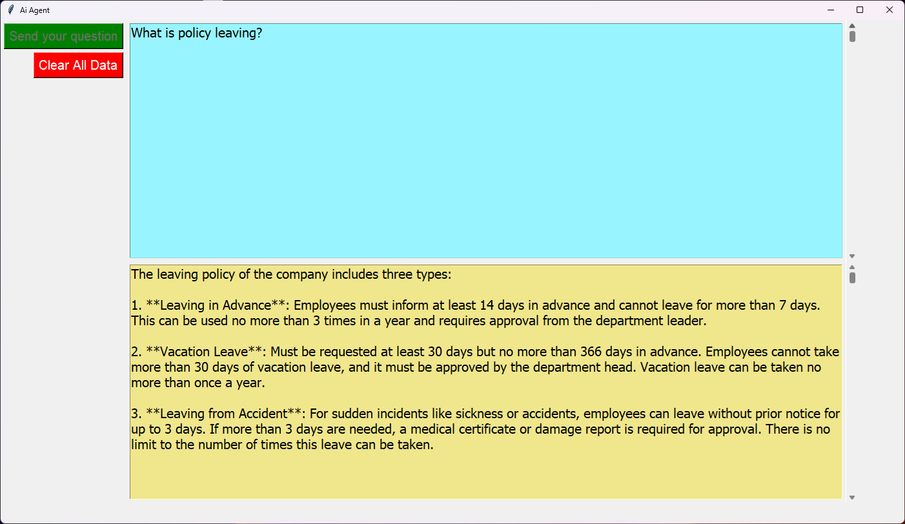
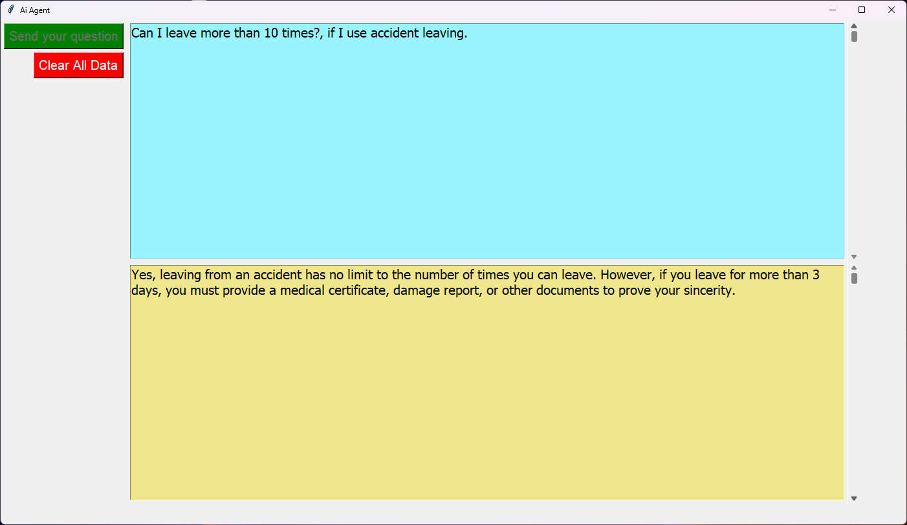
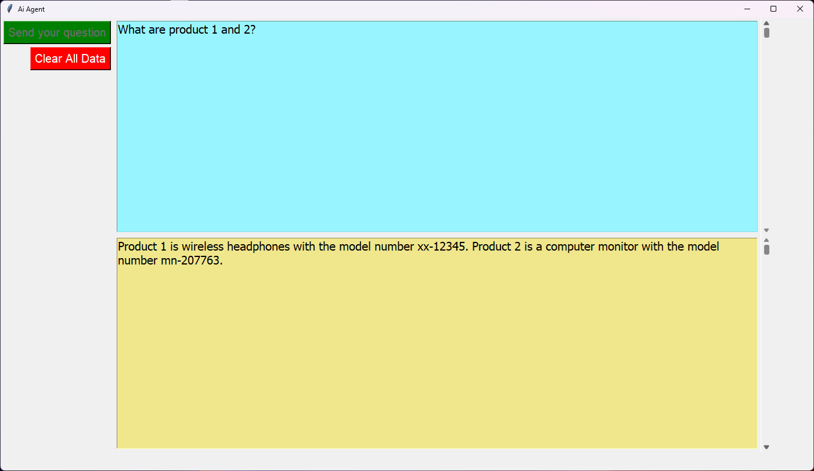
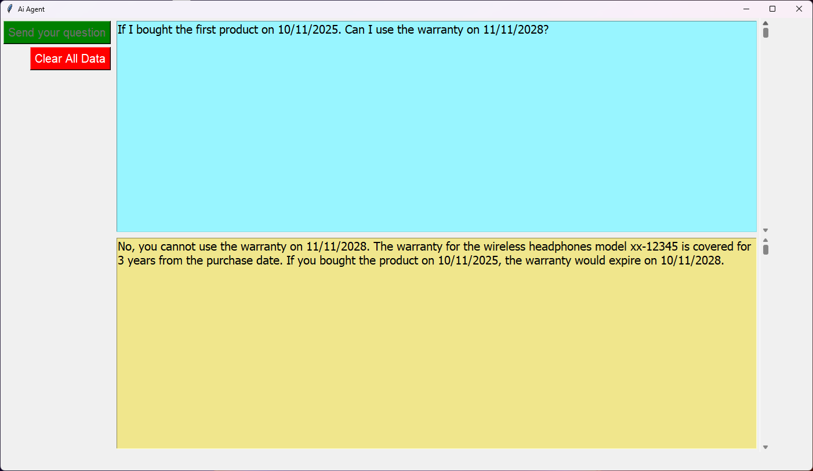
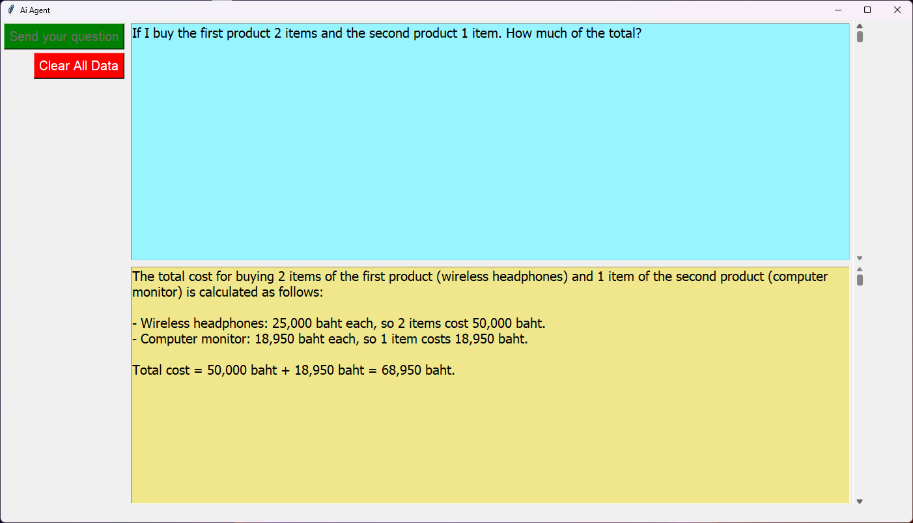
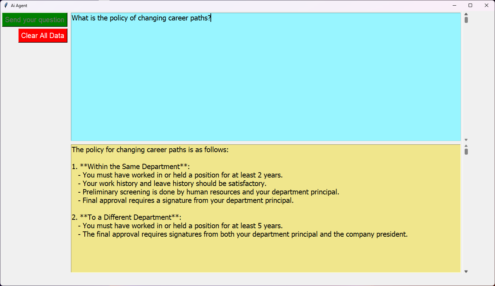
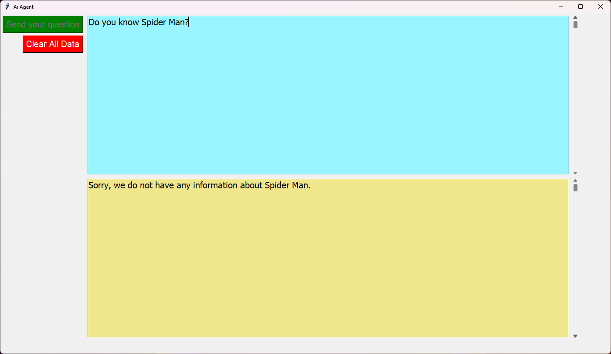
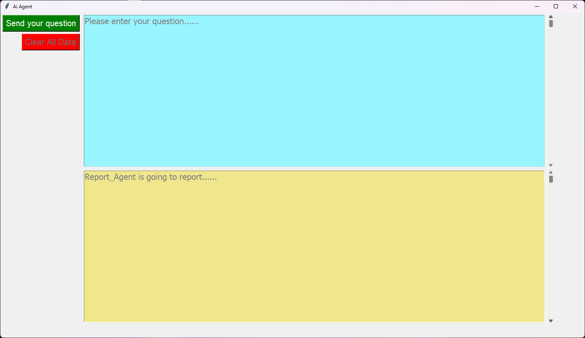

# Agentic AI
## AI Engineer Programming Test

A Python-based application to create a multi-agent system using LangChain, OpenAI, a semantic search tool, custom tools and a basic Tkinter GUI.

## Overview
The application is managed by two AI agents that have different responsibilities.

**1. Data Retriever Agent:** Searches for information in knowledge_base.txt using tools such as semantic search and can also retrieve the current date and time.

**2. Report Generator Agent:** Uses the information that is received from data retriver agent and then generates the final answer to the user.

**3. GUI Dispaly:** In this project, the final result from report generator agent will be shown on the GUI display to present an easy for users to write and read to answers, however for the GUI the user has to write the question and send to data retriever agent in the light blue box and then the answer will be displayed in the below box or light yellow box. Examples will be provided and explained as shown below.

## Examples of Results that Show on the GUI
## The First View of the GUI

**This is the main interface of the application**

**-** The light blue box initially displays the temporary text is "Please send your question......"
  you can write your questions in this box.
  
**-** The green button or Send your question button, after you finish writing your questions you have to click this button to send your questions to data retriever agent but it will take around a few seconds because the data retriever agent and report generator agent they are working in the process.

**-** The red button or Clear All Data button, when the user has already sent the questions and the result is displayed, always user have to click this button to enable the green or Send your question button again and after that user will write the questions again in the light blue box.

**-** The light yellow box initially displays the temporary text is "Report_Agent is going to report......". The text in this box just tells the user that the report generator agent is waiting to create the answer.

## Asking Questions and Responses
This is an example when the question was sent and the result was shown on display.
**First Example**

The result is very satisfactory because the report generator did not give an ambiguous or ramblings answer. However, you can open the knowledge_base.txt file to compare.

**Second Example**

This example shows the report generator can answer a question that has a specific satisfaction level.

**Third Example**

The third example displays when the user asks a question about the other titles in the knowledge_base.txt file. The report generator still generates a good answer and can find the information related to the question.

**Fourth Example**

For this one the question is about the warranty date, as always provides a definitive answer that is very good because this question is very significant hence if the report generator gives the wrong date it could cause the user to misunderstand.

**Fifth Example**

In this case, the question is about calculation which is the result from the report agent is still satisfactory but actually it should have a calculation function as a tool because in some questions it still has incorrect calculate the user can try to write other calculation questions about calculate with the application and check the result, however it still works well if the user provides long or detailed about calculate question. And in the future the developer will add calculate tool to the agent.

**Sixth Example**

For this event, the question is about the final title in the knowledge_base.txt file that is about policy of changing career paths in your departments or other departments. The result from report generator is still good it can give the details briefly.

**Seventh Example**

For the last one of examples, when the user asks the question that is not in the knowledge_base.txt file the report generator will answer like it can not find any informaton about that because the developer created a prompt like "Sorry we do not have any information about your question." in the code.

**The last example**

This example just shows when user clicks the red button or Clear All Data button the GUI will come back and look like the main interface of the application.

# Summary
**-** **The important components of this project** 

**1. RAG (Retrieval-Augmented Generation)**

**-** Read the information from knowledge_base.txt.

**-** Text Splitting to split the text into chunks.

**-** Embedding uses text-embedding-3-small convert text into vectors.

**-** Semantic Search is used as a tool of data retriever agent to find the information that relevant to the user's question.

**-** Retrieval selects the top chunks that involve with the question.

**-** Send the information that found from retrieval to LLM to generate answer.

**2. API**
   **-** In this project used API Integration through OpenAI.

**3. GUI**
   **-** The GUI in this project is used to provide an easy-to use interface to give to user to use to write the question and read the result. 

## Technologies Used
Programming Language: Python 

AI Framework: LangChain

LLM: OpenAI GPT-4o

Embedding Model: OpenAI text-embedding-3-small

Architecture: Multi-Agent System, Retrieval-Augmented Generation (RAG)

Retrieval: Custom Semantic Search using Cosine Similarity

API Integration: OpenAI API

GUI: Tkinter

Custom Tools: Semantic Search, Date and Time

## Version of Python
**-** Python 3.13.3

**-** Required libraries are listed in 'requirements.txt' 

# Important Note
The data in the knowledge_base.txt file it just the made-up information. The details inside are not reference with any real-world market data or economic data. 

